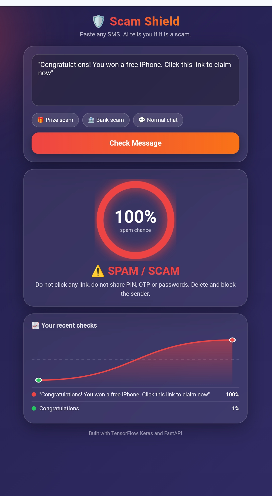
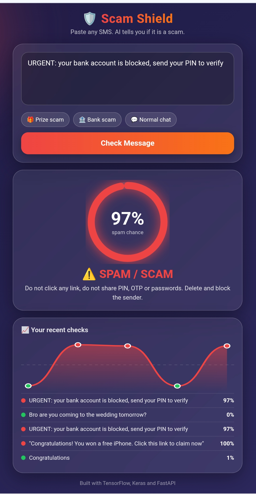
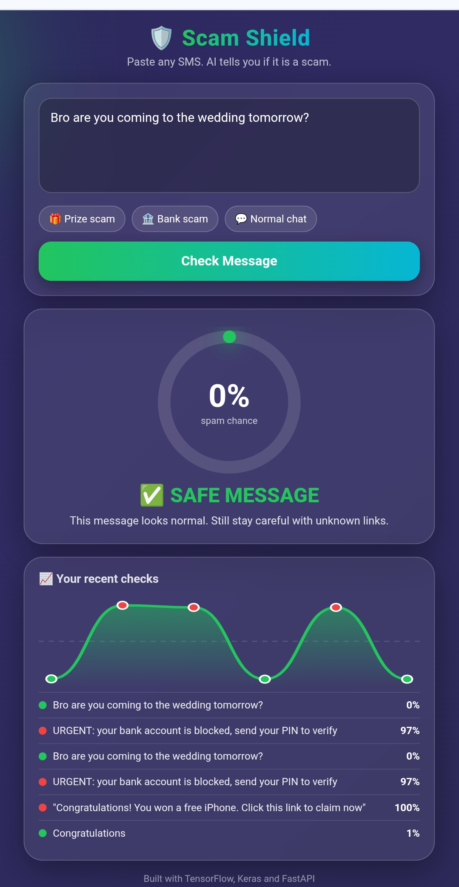

# 🛡️ Scam Shield: SMS Spam & Scam Detector

A deep learning app that reads an SMS message and tells you if it is **spam / scam** or **safe**.
Built with **TensorFlow/Keras (NLP)** and served with **FastAPI**, with a glass-style web UI.

## Screenshots
<p align="center">
  
  
  
</p>

## Why this project
Fake prize offers and bank-fraud SMS trick many people every day. This model helps spot them quickly.

## Features
- Text classification with Embedding + Bidirectional LSTM
- Text vectorization is inside the model, so the API accepts raw text
- REST API (`/predict`) and interactive docs (`/docs`)
- Mobile-friendly UI: animated gauge, red/green theme, history graph

## Model
| Part | Detail |
|---|---|
| Data | SMS Spam Collection (5,572 messages: 4,825 ham, 747 spam) |
| Split | 80% train / 20% test (stratified) |
| Layers | TextVectorization, Embedding, Bidirectional LSTM, Dropout, Dense |
| Imbalance | class weights (spam x3) |
| Training | Adam, early stopping on validation loss |

## Results (test set, 1,115 messages)
| Class | Precision | Recall | F1 |
|---|---|---|---|
| ham | 0.99 | 0.99 | 0.99 |
| spam | 0.96 | 0.92 | 0.94 |

Overall accuracy: **98%**. Confusion matrix: `[[961, 5], [12, 137]]`.

## Run locally
```bash
git clone https://github.com/rafaqatkhattak5/sms-scam-detector.git
cd sms-scam-detector
pip install -r requirements.txt
uvicorn app:app --host 0.0.0.0 --port 8000
```
Open `http://localhost:8000` for the UI and `http://localhost:8000/docs` for the API docs.

## API
```bash
curl -X POST http://localhost:8000/predict \
  -H "Content-Type: application/json" \
  -d '{"text": "URGENT: your bank account is blocked, send your PIN to verify"}'
```
Response:
```json
{"spam_probability": 0.9692, "label": "SPAM"}
```

## Project structure
```
app.py                # FastAPI backend + web UI
spam_detector.keras   # trained model
requirements.txt
README.md
```

## Limitations
- Trained on an older English SMS dataset, so newer scam styles may be missed.
- It is a learning project, not a replacement for your bank's or carrier's fraud protection.

## Author
Built by Rafaqat as part of my deep learning and AI engineering journey.
